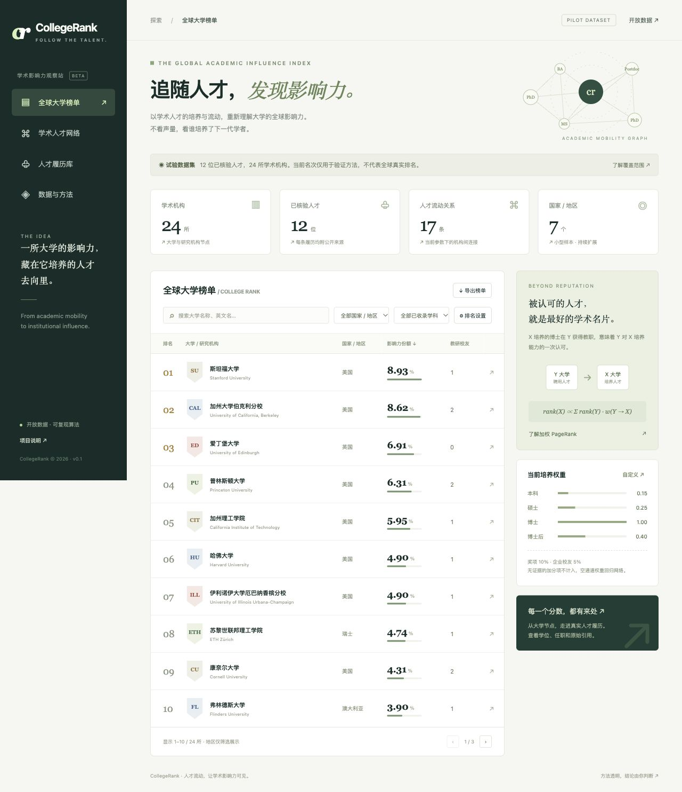

# CollegeRank

**追随人才，发现影响力。** 一个以学术人才流动为基础、可引用、可复现的大学与研究机构排名实验。

如果 X 培养的博士在 Y 获得教职，记录 **Y → X** 的认可关系，再用稀疏加权 PageRank 计算培养机构的网络影响力。本科、硕士、博士和博士后经历可分别设置权重，奖项与当前企业校友作为独立信号。

> **当前是可运行的研究 MVP，不是已经爬完全球的权威排名。** 首发包含 12 位有官方来源的真实人才、24 所学术机构、1 家企业，覆盖 7 个国家或地区。计算机与数学样本明显偏多。网页中的全部名次只用于验证方法。

## 本地启动

需要 Python 3.11+；运行网站及采集器 **不需要安装第三方 Python 包，也不需要 API Key**。

```bash
python3 -m collegerank serve
```

打开 <http://127.0.0.1:8000>。默认仅本机可访问。更换端口：`python3 -m collegerank serve --port 8080`。

也支持 `npm run dev`；Node 18+ 用于浏览器算法测试，网站本身是原生 HTML/CSS/ES modules，无前端依赖。



## 已实现

- 响应式中文排行榜、大学中英文检索、国家筛选、学科重算、分页、CSV 导出。
- 学校详情：学位来源、当前任职、入边/出边、贡献权重、人才与奖项原始链接。
- SVG 人才流动网络、可搜索人才履历库、完整方法与覆盖说明。
- 可调培养权重、阻尼、荣休/兼职/自聘、奖项强度、企业范围及加分混合比例；参数 JSON 导出。
- Python / 浏览器 JavaScript 两套稀疏 PageRank，同一数据与参数下交叉验证。
- Wikidata 公共结构化数据采集：机构配置、稳定排序分页、断点续跑、缓存、限速、重试、原始记录与引用保存。
- 候选与核验数据隔离，SQLite 内容哈希快照，数据校验。
- GitHub Actions 测试、每周采集候选数据工件、GitHub Pages 静态部署。

## 排名规则

```text
A[Y,X] = Σ(person, education) weight(education) / 当前有效任职机构数
P[Y,X] = A[Y,X] / Σk A[Y,k]
r = (1-d)/N + d Pᵀr              d = 0.85
```

Y 是聘用机构，X 是培养机构；不是把边反过来奖励聘用学校。

| 培养经历 | 默认权重 |
| --- | ---: |
| 本科 | 0.15 |
| 硕士 | 0.25 |
| 博士 | 1.00 |
| 博士后研究经历 | 0.40 |

博士后不是学位，但可以作为独立培养经历。一人同一机构同一层级只计一次；联合任职按有效机构均分；未知学位、荣誉学位、未确认在职、候选记录、核验超过 730 天的数据不进入人才流动图。默认不计自聘和荣休任职，可调整。

悬挂节点的质量均匀分发，L1 残差小于 `1e-12` 停止，最多 1000 次迭代。单轮复杂度 O(N+E)，存储邻接边，不分配 N×N 稠密矩阵。

```text
最终份额 = (1 - α - β) × PageRank
         + α × normalized(奖项贡献)
         + β × normalized(当前企业校友贡献)
α = 0.10，β = 0.05
```

归一化份额合计 1（界面显示百分比）；空的加分通道份额回归 PageRank。奖项按类型与年份去重，并按教育权重分配到培养机构。企业贡献每人只计一次，按教育权重分配。

**数学三大奖**暂定义为菲尔兹奖、阿贝尔奖、沃尔夫数学奖，且支持诺贝尔奖、图灵奖、IEEE Medal of Honor 和 IEEE Edison Medal。IEEE Milestone 是技术成就/地点表彰，使用独立 `milestones` 机构事件，不能当作个人获奖。当前尚无 Milestone 数据。请参见 [IEEE 官方说明](https://history.ieee.org/ieee-milestones-program/)。

企业名单与权重是可修改假设，不存在无需解释的“客观顶尖公司”。仅有来源支持的**当前任职**才计分，过去任职、董事、顾问不算。初始数据的 insitro 默认不在企业加分名单内，因此默认企业加分为零。在设置中添加 `insitro` 可以验证该通道。所有附加项都可以设置为零，恢复纯人才流动排名。

地区筛选只改变展示，保留全图名次；学科筛选会先筛人才，再重算全图。当前不提供“毕业生获教职概率”，因为缺少完整毕业生人数分母。

原始 PageRank 参考 [Brin & Page (1998)](https://research.google/pubs/the-anatomy-of-a-large-scale-hypertextual-web-search-engine/)。本项目是加权扩展，且额外指标并非原算法的一部分。单向人才流动不能证明一所学校在所有维度更好。

## 自动采集

编辑 `config/sources.json` 中的 Wikidata 机构 ID，可加入大学、研究院和研究机构。默认只选 8 所机构作为采集起点。

```bash
python3 -m collegerank crawl --limit 25
```

每所机构每次最多采集 25 人，重新运行从上次成功页继续；到末页后下次从头刷新。生成：

| 文件 | 用途 |
| --- | --- |
| `data/candidates.json` | 待核验人才与机构，不进入已发布榜单 |
| `data/crawl-state.json` | 每机构分页游标，整页成功才推进 |
| `data/crawl-report.json` | 本次采集数量、机构完成状态和错误 |
| `data/cache/` | 公共 API 原始响应，24 小时缓存 |

采集 P108（employer）、P69（educated at）、P512（academic degree qualifier）、P166（award received）及原始引用。**P108 没有结束日期不等于当前在职；P69 不等于博士毕业**，这两类情况保留 `null` / `unknown`，等待核验。Wikidata 学位类映射只覆盖常见项目，地方学位与博士后职位需要官方资料补充。候选机构类型同样需核验。

采集仅限公开 Wikidata API，默认请求间隔至少 1.1 秒；429 / 5xx 最多重试 4 次。不能访问时报告错误，不使用旧页面冒充本次更新，不绕过反爬或证书验证。Python.org 安装版 macOS Python 如报证书错误，先运行其安装目录中的 `Install Certificates.command`，或配置可信 CA；不要关闭 TLS 校验。

**真实联网验证限制：** 此开发环境的公共 Wikidata 请求遇到证书/上游访问限制，尚未确认实时采集完整成功。采集解析、失败保护及游标逻辑已有离线测试；上线后需在 GitHub Actions 检查成功报告。定时工作流只有在项目推送到 GitHub 后才会运行。

### 核验候选并加入榜单

1. 找到机构官方人员目录、个人主页/CV、授予学位记录或奖项官网。
2. 核对姓名、同名消歧、机构实体、学位层级、是否荣誉学位、职位和任职状态。不要把 Wikidata 的所有历史雇主当成当前工作。
3. 把候选里的 `wd:Q…` 机构映射到 `data/curated.json` 已有 ID；同一个人需要人工消歧后合并，不能新增重复身份。
4. 将有证据的字段补齐、附上 `sources`，更新 `checked_at` 并标记 `reviewed`，通过数据 PR 提交。
5. 执行 `validate`、测试和 `export`；`main` 上的 Pages 工作流发布新的榜单。

这是一个证据优先的自动发现 + 审核发布流程。**尚未实现全世界所有 faculty 的官方目录爬取、自动跨语言 CV 解析、自动人员消歧或无人审核的全量排名。** 全球覆盖需要各机构目录适配器与持续的数据维护，不能靠一个通用爬虫保证。详见 [路线图](docs/ROADMAP.md)。

## 数据与复现

```bash
python3 -m collegerank validate
python3 -m collegerank rank --config config/example-weights.json
python3 -m collegerank export --config config/example-weights.json
python3 -m unittest discover -s tests -v
node --test tests/*.test.mjs
```

`export` 生成 `site/data.json`、`site/ranking.json`、`site/ranking.csv`，同时将数据快照保存为 `data/college-rank.sqlite`。数据 JSON 包含用于重现的 SHA-256。网页初始数据从 JSON 读取，并在浏览器即时重算，所有链接和资源都使用相对路径，适配 GitHub Pages 仓库子路径。

数据结构与事件示例见 [DATA_MODEL.md](docs/DATA_MODEL.md)。样例数据只使用公开的专业履历，不收集私人联系方式。

## 发布到 GitHub

开源仓库：[CanXINlol/college-rank](https://github.com/CanXINlol/college-rank)，代码采用 MIT License。首次克隆后按上文启动即可。

如果发布自己的副本，请在 GitHub 创建空仓库，然后配置自己的远程地址：

```bash
git remote add origin https://github.com/YOUR_USERNAME/college-rank.git
git push -u origin main
```

在仓库 **Settings → Pages → Source** 选择 **GitHub Actions**。`Publish CollegeRank to GitHub Pages` 工作流将部署网站，地址通常为 `https://YOUR_USERNAME.github.io/college-rank/`。定时采集每周一 02:30 UTC 执行，也可以在 Actions 手动触发；候选结果以 Artifact 下载，不会直接覆盖核验数据。GitHub 可能暂停长期无活动仓库的定时任务，应检查 Actions 状态。

## 目录

```text
collegerank/      Python 排名、校验、SQLite 快照、采集 CLI
site/            无依赖前端，原生 JS 排名、图、详情与引用
data/curated.json 已核验人才数据
config/          数据源与权重配置
tests/           数学边界、采集保护、Python/JS 结果一致性
scripts/         首批数据重建工具
docs/            方法、数据模型、路线图、UI 截图
.github/         自动测试、Pages、定时采集与 PR 模板
```

代码采用 [MIT License](LICENSE)。本项目整理的事实数据以 [CC0](https://creativecommons.org/publicdomain/zero/1.0/) 提供；引用网页及其文字的权利仍归原权利人。Wikidata 数据依据其 [CC0 数据许可](https://www.wikidata.org/wiki/Wikidata:Licensing)。欢迎有来源的数据 PR 与方法改进。
